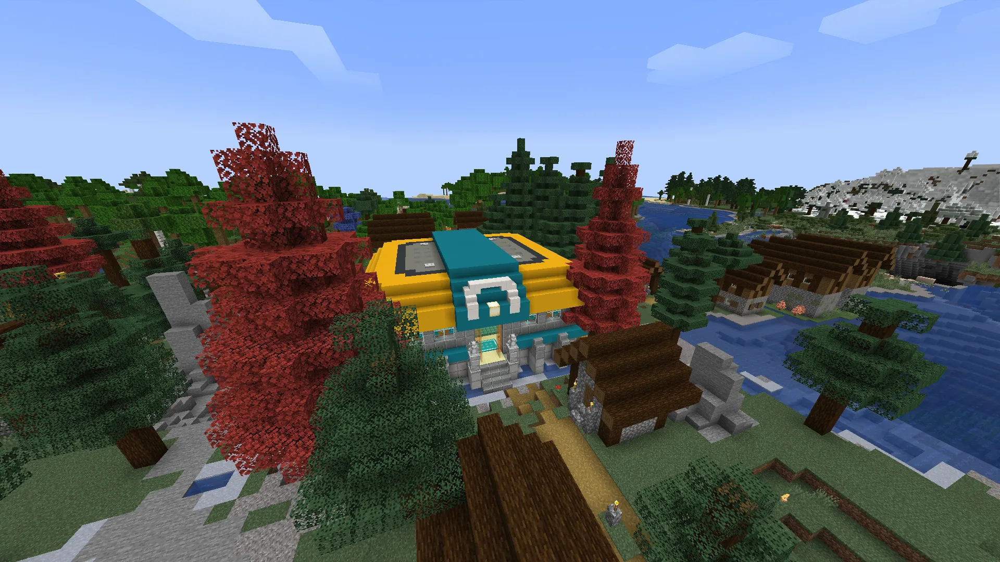
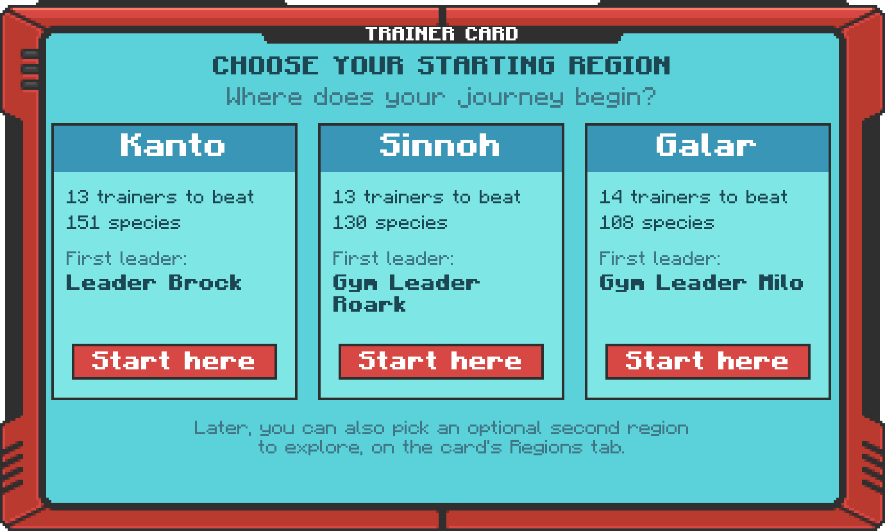
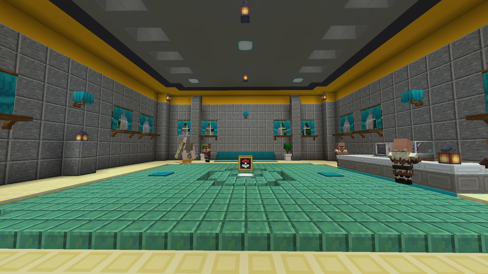
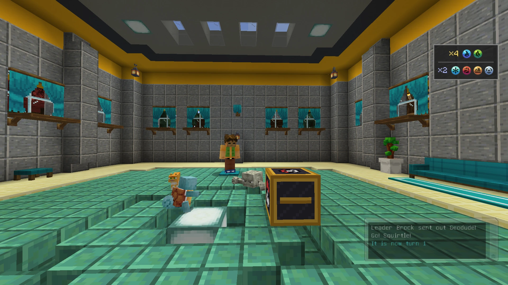
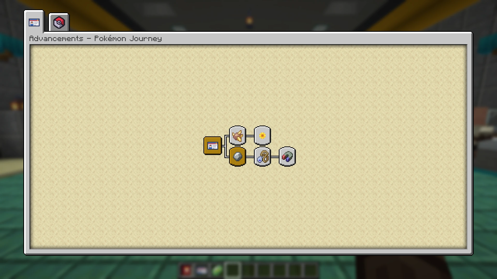
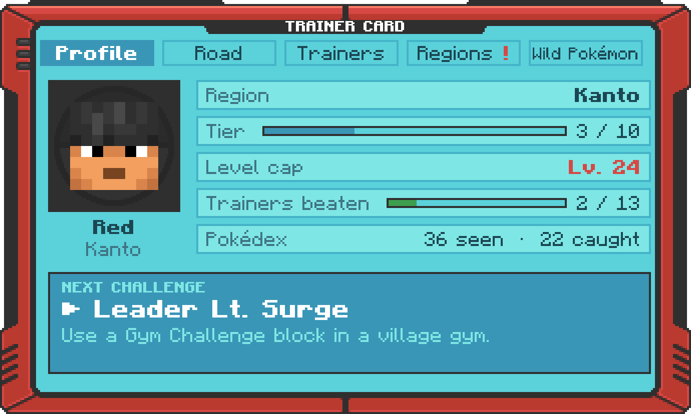
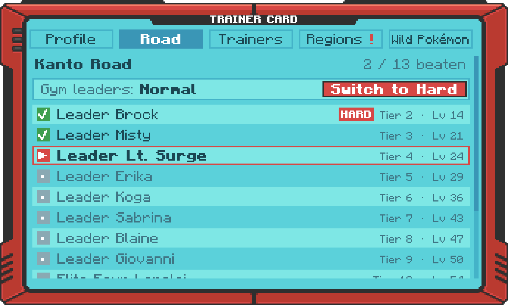
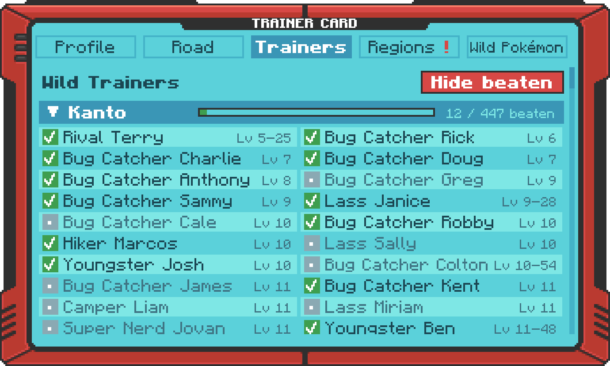
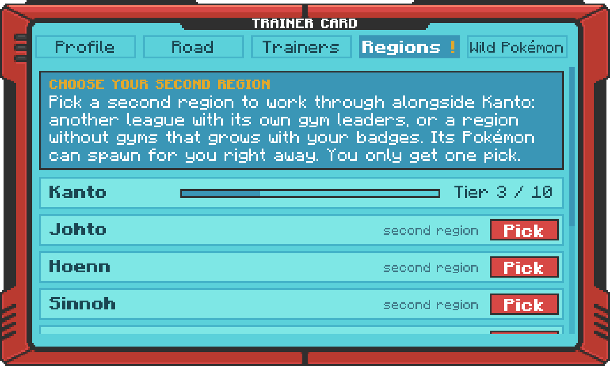
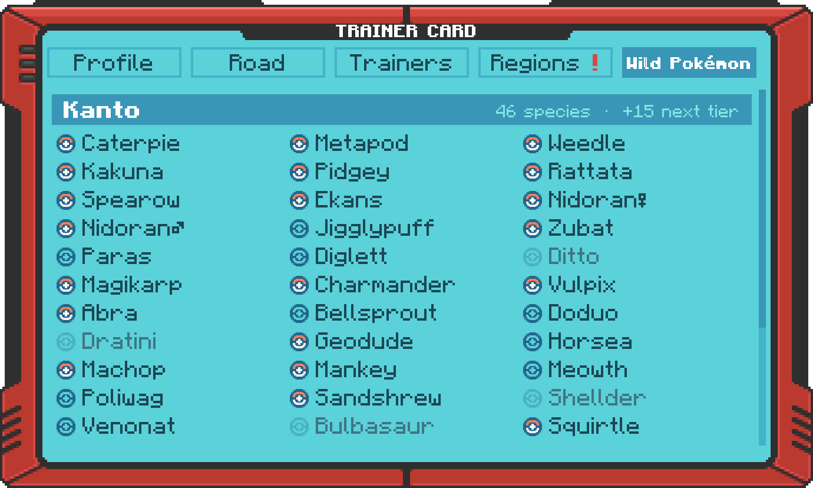

# Cobblemon Journey Progression

*Formerly Ultimate Cobblemon Progression (UCP).*

A Fabric side-mod for **Cobblemon** that turns the game into a region-by-region Pokémon journey. Start in a region, find its gyms in villages, beat its leaders, and unlock its Pokémon tier by tier: what spawns, how strong it is, and how far your team can level all grow with your progress.

**Requires Cobblemon 1.8** (Minecraft 1.21.1, Fabric). Latest release: [2.10.1](https://github.com/Lucalaure/ultimate-cobblemon-progression/releases/latest).



## Why play CJP?

Cobblemon is a great sandbox, but out of the box there's no journey: from your first night you can run into anything, and nothing stops a level-60 Pokémon from ending your first gym battle before it starts. CJP brings back the pacing of the main-series games without taking the sandbox away.

- **Every badge means something.** Each leader you beat opens the next part of the region's Pokémon, makes wild Pokémon stronger and raises your level cap. You always know what you're working towards, and the next leader is always a fair fight.
- **The Pokémon you can catch fit the leader you're about to face.** Pokémon are unlocked by their strength (Base Stat Total), so you never get stuck with nothing that stands a chance, and you never steamroll a gym with something you shouldn't have yet.
- **It's still Minecraft.** You don't follow routes or a story: explore wherever you like, build, and find gyms in villages. CJP only decides which Pokémon spawn for you and how strong they are.
- **A full league, then more.** Eight gyms, the Elite Four and the Champion in Kanto, Sinnoh and Galar, with the original games' teams. After becoming Champion you pick where your journey goes next, and every Pokémon from the regions you've finished keeps spawning.
- **As hard as you want it.** Normal leaders play like the original games. Hard leaders bring bigger, fully trained teams. On top of that, optional challenges ask you to catch every Pokémon before the next gym, or to bring no more Pokémon than the leader.
- **Made for servers and modpacks too.** Every player has their own journey, region and level cap, and everything is configurable and datapack-driven.

## Documentation

- **[How CJP Works](docs/how-it-works.md)**: the full guide to regions, gyms, the Trainer Card, tiers, rarity, spawning, wild levels, the level cap, configuration, datapacks and commands.
- **[Species by Tier and Rarity](docs/species-by-tier.md)**: every naturally spawning Pokémon, its tier, and how rare Cobblemon makes it.
- **[Changelog](CHANGELOG.md)**
- **[Roadmap](docs/roadmap.md)**: planned features.

---

## Installing

Required:

- **[Cobblemon 1.8](https://modrinth.com/mod/cobblemon)**
- **[Fabric API](https://modrinth.com/mod/fabric-api)**
- **[Fabric Language Kotlin](https://modrinth.com/mod/fabric-language-kotlin)**
- **[Cardinal Components API](https://modrinth.com/mod/cardinal-components-api)**

For the region journey (gyms and the built-in Kanto, Sinnoh and Galar leagues), also install:

- **[Radical Cobblemon Trainers](https://modrinth.com/mod/rctmod)** (RCT): the trainers, their teams and their battles. It needs [RCT API](https://modrinth.com/mod/rctapi), [Architectury API](https://modrinth.com/mod/architectury-api) and [Forge Config API Port](https://modrinth.com/mod/forge-config-api-port).
- **[CobbleFurnies](https://modrinth.com/mod/cobblefurnies)**: furniture used inside the gym buildings. It needs [Athena](https://modrinth.com/mod/athena-ctm).

Optional:

- **[RCT Trainer Textures Plus](https://modrinth.com/resourcepack/rct-trainer-textures-plus)** (resource pack, recommended): gym leaders that look like themselves.
- **[Cobblemon: Mega Showdown](https://modrinth.com/mod/cobblemon-mega-showdown)**, for Dynamax and Gigantamax. Galar's leaders then Dynamax their ace as in Sword and Shield, and every Gym Challenge block is a Power Spot, so you can Dynamax there too with a Dynamax Band.
- **[PokeBadges](https://modrinth.com/mod/pokebadges)**: every badge you earn is also a badge item for your Badge Box.
- **[Mod Menu](https://modrinth.com/mod/modmenu)**: an in-game settings screen.

Don't install [Radical Gyms & Structures](https://modrinth.com/datapack/radical-gyms-cobblemon) alongside CJP: CJP already ships its gym buildings, and RGS would add more of them outside villages.

Without RCT, CJP still works, using its original trainer-level ladder (see [Classic mode](#classic-mode-trainer-levels)).

---

## How it plays

1. **Pick where your journey starts.** Every player gets a **Trainer Card** on joining. The first time you open it, it asks which region to start in: Kanto, Sinnoh or Galar. That region opens, and you pick your starter from that region's starters, at level 5.
2. **Find a gym.** New villages can have a **gym** at their centre, one at most per village. Using its **Gym Challenge** block summons your next leader into the arena; sneaking while using it lets you rematch any leader you've already beaten. One leader stands in a gym at a time.
3. **Beat the leader to unlock the next tier.** Each badge opens more of the region's Pokémon, stronger wild levels and a higher level cap. The first time you beat a leader, they give you their TM from the games and a reward bundle that grows through the league. After the eight gyms come the Elite Four and the Champion, and beating the Champion completes the region.
4. **Choose where your journey goes next.** Once you're Champion, your Trainer Card asks which league to travel to next. Your journey continues there from its first gym, with a fresh level cap. The regions you've finished stay open: their Pokémon keep spawning, mostly at levels that fit your new team.
5. **Track it all on your Trainer Card and in the Pokémon Journey tab.** Every badge, Elite Four win, Champion title and fully caught tier is an advancement in its own advancement tab.

<p align="center"></p>

### Village gyms

Gyms replace the centre of some new villages. Inside, the **Gym Challenge** block in the middle of the arena summons your next leader, with the team they use in the games.

| Inside a gym | Battling Brock |
|--------------|----------------|
|  |  |

### The Pokémon Journey tab

Every badge, Elite Four win and Champion title is an advancement in its own tab, with each leader's signature item as its icon. Hidden advancements for catching every Pokémon of a tier sit alongside them.



### The Trainer Card

Your Trainer Card is where your journey lives:

- **Profile**: your region, tier, level cap, trainers beaten, Pokédex count and your next challenge.
- **Road**: every leader, Elite Four member and Champion of your league in order, their tier and level, which ones you've beaten (and on which difficulty), and the Normal/Hard switch.
- **Trainers**: every wild trainer of your open regions, weakest first, with their level and whether you've beaten them.
- **Regions**: every region's progress, and where you pick your second region.
- **Wild Pokémon**: every Pokémon you can meet right now, with Cobblemon's caught and seen markers, and how many the next tier adds.

| Profile | Road |
|---------|------|
|  |  |
| **Trainers** | **Regions** |
|  |  |

<p align="center"></p>

### Features

- **Three full leagues.** Kanto (FireRed/LeafGreen teams), Sinnoh (Brilliant Diamond/Shining Pearl) and Galar (Sword and Shield, with both leaders of gyms 4 and 6, the Champion Cup and Leon). Every other region, Johto to Paldea, can be opened as an extra region that grows with your badges.
- **[Normal or Hard gyms](docs/how-it-works.md#gym-difficulty).** Normal leaders play like the original games. Hard leaders add one or two Pokémon, all at their ace's level, with perfect IVs, EVs, held items and real movesets. Switch any time on the Road tab; either earns the badge.
- **[Leader rewards](docs/how-it-works.md#leader-rewards).** Each leader gives their TM and a reward bundle the first time you beat them, from Great Balls and Exp. Candy early on to Rare Candies and Ability Capsules later. Champions give a Master Ball. Beating a leader on Hard also gives a stone or type item of their type.
- **[Two leagues at once](docs/how-it-works.md#two-leagues-at-once).** Make your second region another league and work through both side by side, with a level cap between the two.
- **[Wild trainers by region](docs/how-it-works.md#wild-trainers).** FireRed's, BDSP's and Sword and Shield's trainers spawn in the wild once their region is open, with their real teams and their level on their name tag.
- **[Regional forms](docs/how-it-works.md#regional-forms) belong to their own region.** Alolan Rattata needs Alola, Galarian Ponyta needs Galar.
- **Starters from your region**, at level 5, as in the games.
- **Optional challenges**, all off by default:
  - [Catch every Pokémon](docs/how-it-works.md#catch-every-pokémon-optional) of your tier before you can face the next leader.
  - Bring no more Pokémon to a gym than the leader has.
  - Only bring Pokémon from regions you've opened to a gym (no traded or bred shortcuts).

### The built-in leagues

With RCT installed, CJP turns on a built-in datapack, **CJP Kanto, Sinnoh & Galar Leagues**, with each league's 10 tiers, gym leaders, Elite Four (or Champion Cup) and Champion, plus every other region as an optional extra region. It's an ordinary datapack, so you can turn it off, or override it with your own region data. See [Region mode](docs/how-it-works.md#9-region-mode).

---

## What changes for wild Pokémon

Whether you follow regions or the classic ladder, your progress controls:

- **Which species can spawn** for you: Pokémon above your tier (or from regions you haven't reached) are blocked. Fishing follows the same rules.
- **How strong wild Pokémon are**: levels are rerolled based on the Pokémon's tier and yours.
- **Which region's Pokémon you meet most**: in region mode, the region you're working through is favored over the ones you've finished (see [spawn pools](docs/how-it-works.md#wild-pokémon-in-a-new-region-spawn-pools)). Otherwise, unlocking a tier only adds Pokémon.

**Rarity is still Cobblemon's.** Whether a Pokémon is common or ultra-rare comes from Cobblemon's spawn data, and CJP doesn't change those odds. Tiers measure strength, not rarity, so a Pokémon can be low-tier and ultra-rare (Dratini) or high-tier and common (Slaking). See [Rarity](docs/how-it-works.md#3-rarity-whats-rare-and-whats-not).

---

## Classic mode: trainer levels

Without region data (for example without RCT, or with the built-in leagues turned off), CJP gives every player a **Trainer Level** from 1 to 7. Each level is a tier, and you level up automatically by seeing and catching enough different species in your Pokédex. Your Pokémon can't gain XP past your tier's level cap.

| Tier | Base Stat Total | Level cap | To reach it (seen / caught) |
|------|-----------------|-----------|------|
| 1 | 175 – 305 | 15 | start |
| 2 | 306 – 354 | 27 | 30 / 10 |
| 3 | 355 – 440 | 40 | 80 / 20 |
| 4 | 441 – 475 | 54 | 140 / 35 |
| 5 | 476 – 500 | 69 | 210 / 55 |
| 6 | 501 – 570 | 85 | 290 / 80 |
| 7 | 571 and up | 100 | 380 / 110 |

The default tiers also cover species from Myths and Legends, Complete Cobblemon Collection, Mega Showdown and MysticMons, but CJP doesn't require them. Tiers are datapack-driven, so you can replace them: see [Custom tiers](docs/how-it-works.md#7-custom-tiers-datapacks).

---

## Commands

```
/trainerlevel get                          your progress (everyone)
/trainerlevel card                         a new Trainer Card, if you lost yours (everyone)
/trainerlevel region next <region>         travel to your next region, once yours is complete (everyone)
/trainerlevel region choose <region>       pick your extra starting region (everyone)
/trainerlevel region reset <player>        clear a player's extra region choice (op level 2)
/trainerlevel difficulty [normal|hard]     show or change your gym difficulty (everyone)
/trainerlevel set <player> <level>         classic mode: set a trainer level (op level 2)
/trainerlevel promote <player>             classic mode: raise a player one level (op level 2)
```

## Configuration

Settings live in `config/ultimate-cobblemon-progression/`, and most are also on the Mod Menu screen. Highlights from `ucp-common.json`:

- `gymVillageChance` (default `0.3`): the share of new villages whose centre is a gym. `0` turns village gyms off.
- `giveTrainerCard` (default `true`): give every player a Trainer Card on their first join.
- `regionStarters` (default `true`) and `starterLevel` (default `5`): your starter comes from the region your journey starts in, picked once you've chosen it, at level 5.
- `gymDifficulty` (default `"player_choice"`): each player picks Normal or Hard gym leaders on their Trainer Card and can switch any time; `"normal"` or `"hard"` sets it for everyone. See [Gym difficulty](docs/how-it-works.md#gym-difficulty).
- `allowTwoLeagues` (default `true`): players may pick a second league, with its own gym leaders, and work through both at once. Gyms ask which league's leader to battle, and the level cap is the average of the two (or the lower of the two, with `twoLeagueCap` set to `"lowest"`). See [Two leagues at once](docs/how-it-works.md#two-leagues-at-once).
- `catchWholeTier` (default `false`): difficulty option, catch every Pokémon of your tier before you can face the next gym leader (your extra region also waits until its tier is caught).
- `gymTeamLimit` (default `false`): difficulty option, bring no more Pokémon to a gym battle than the leader has.
- `gymLegalityCheck` (default `"off"`): `"warn"` or `"block"` gym battles while your party has Pokémon you couldn't have yet (from eggs, trades or fossils). Your starter is always allowed.
- `gymLegalityRule` (default `"region"`): what that check allows. `"region"`: any Pokémon of a region you've opened, evolutions included, within your level cap (regional forms need their own region). `"strict"`: only Pokémon of tiers you've unlocked, as they spawn in the wild, within your level cap.

And from `ucp-spawn.json`:

- `regionPoolWeight`, `pastInCapPoolWeight`, `pastFullPoolWeight` (defaults `1.0`, `0.5`, `0.15`): how often you meet the region you're working through, finished regions' Pokémon at your new team's levels, and finished regions' Pokémon at full strength. See [spawn pools](docs/how-it-works.md#wild-pokémon-in-a-new-region-spawn-pools).
- `doWeightScaling` (default `false`): favor Pokémon closer to your tier within each rarity. Off, unlocking a tier only adds Pokémon.

The full list is in [Configuration](docs/how-it-works.md#6-configuration).

---

## Credits

- Based on **[Ultimate Cobblemon Progression](https://github.com/ppVon/ultimate-cobblemon-progression)** by ppVon (MIT), which this project continues independently.
- Gym buildings adapted from **[Radical Gyms & Structures](https://modrinth.com/datapack/radical-gyms-cobblemon)** by JayOnline (MIT). Its notice is in [`src/main/resources/licenses/`](src/main/resources/licenses/).
- Trainers and battles by **[Radical Cobblemon Trainers](https://modrinth.com/mod/rctmod)**. The Trainer Card uses Cobblemon's own Pokédex art, loaded from your Cobblemon install.
- Kanto's wild trainer teams come from **[pret's FireRed decompilation](https://github.com/pret/pokefirered)**.

## Building

Requires JDK 21.

```
./gradlew build
```

The mod jar is written to `build/libs/`. `scripts/` has the tools that generate the default tiers, region tiers, and the gym buildings from RGS.
